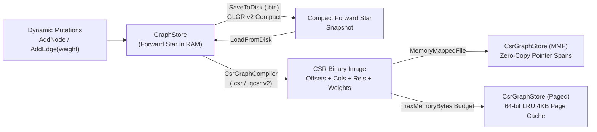

# Glacier.Graph Architecture (`v1.1.0`)

`Glacier.Graph` is a zero-allocation, Native AOT-compatible graph storage and traversal engine targeting **.NET 10**. It provides two complementary representations—a dynamic read/write **Forward Star** engine (`GraphStore`) and a static memory-mapped / LRU-paged **Compressed Sparse Row (CSR)** engine (`CsrGraphStore`)—paired with pooled generation-tagged traversal workspaces, hardware SIMD intrinsics (`Vector512` / `Vector256` / `Vector128`), and a source-generated JSON-RPC 2.0 Model Context Protocol (MCP) server.

---

## 1. Dual Storage Engines

### 1.1 Dynamic Forward Star (`GraphStore`)
Traditional object-oriented graph libraries allocate heap objects per vertex and edge (`Node`, `Edge`, `List<Edge>`), causing severe GC pressure and pointer-chasing cache misses. `GraphStore` stores the entire topology in contiguous primitive arrays indexed by 1-based internal integer IDs (`1 .. NodeCount`) and edge indices (`1 .. EdgeCount`):

- `_head[nodeId]`: Head edge index of the outward linked list for `nodeId` (`0` if out-degree is zero).
- `_to[edgeIdx]`: Target internal node ID.
- `_relation[edgeIdx]`: Interned integer relation predicate ID.
- `_next[edgeIdx]`: Next outward edge index for the same source node (`0` at end of list).
- `_weights[edgeIdx]`: Non-negative `float` edge weight (`>= 0.0f`, validated against `NaN`, `Infinity`, and negative values).
- `_nodeMetadata[nodeId]`: Optional string metadata per node.

#### Concurrency & Memory Safety
- `GraphStore` implements `IDisposable` over a `ReaderWriterLockSlim`.
- Mutations (`AddNode`, `AddEdge`) acquire a write lock before resizing `_head`, `_to`, `_relation`, `_next`, or `_weights`.
- Whole-graph read operations (`GraphSearch` traversals, `SaveToDisk`, and `CsrGraphCompiler.CompileFromForwardStar`) acquire a read lock across the entire operation and iterate via an internal stack-allocated `RawEdgeEnumerator` (`0` GC allocations).
- Public `GetOutwardEdges` / `GetOutwardEdgesByInternalId` capture an atomic snapshot under the read lock so external callers can never observe torn `Array.Resize` state without manually managing locks.

#### Compact `GLGR` v2 Persistence
`SaveToDisk` serializes only active node slots (`0 .. _nodeCount`) and active edge slots (`0 .. _edgeCount`) rather than pre-allocated array capacities, keeping small graph snapshots sub-kilobyte while preserving raw `MemoryMarshal.AsBytes` bulk I/O speed for multi-million-edge graphs. `LoadFromDisk` validates magic bytes, schema version (`1` and `2`), non-negative counts, and `edgeCap == 0` / empty-graph edge cases, throwing `InvalidDataException` on truncated or corrupt files.

---

### 1.2 Static Compressed Sparse Row (`CsrGraphCompiler` & `CsrGraphStore`)
`CsrGraphCompiler.CompileFromForwardStar` compacts a `GraphStore` under its read lock into the **`GCSR` v2** binary layout:

| Section | Type | Length | Description |
| :--- | :--- | :--- | :--- |
| Header | Magic + `int32` x 3 | Variable | `"GCSR"`, Version (`2`), `NodeCount`, `EdgeCount` |
| Relation Dictionary | `(string, int32)` | `RelCount` | Interned relation names and IDs |
| Node ID Map | `(string, int32)` | `NodeCount` | External string IDs <-> 1-based internal IDs |
| Node Metadata | `string[]` | `NodeCount + 1` | Active node metadata slots only |
| `rowOffsets` | `int32[]` | `NodeCount + 2` | Contiguous slice offsets per 1-based node |
| `columnIndices` | `int32[]` | `EdgeCount` | Contiguous target internal node IDs |
| `edgeRelations` | `int32[]` | `EdgeCount` | Contiguous relation type IDs |
| `edgeWeights` | `float32[]` | `EdgeCount` | Contiguous non-negative edge weights (`v2`) |

`CsrGraphStore` validates the file header, version (`v1` legacy unweighted and `v2` weighted), and exact byte length (`_fs.Length >= requiredLength`) prior to mapping, disposing file handles deterministically and throwing `InvalidDataException` on truncated or malformed inputs.

Two execution modes are supported transparently:
1. **Direct Memory-Mapped File (`useMemoryMapping: true`)**: Maps the CSR file via `MemoryMappedFile` and exposes zero-copy `ReadOnlySpan<int>` and `ReadOnlySpan<float>` slices (`TryGetNeighbors`, `TryGetNeighborsAndWeights`, `GetEdgeWeightsSpan`). Dead software cache buffers are not allocated when MMF succeeds.
2. **Bounded Software LRU Page Cache (`useMemoryMapping: false`)**: Enforces a strict RAM budget (`maxMemoryBytes`) using fixed 4 KB pages, a 64-bit monotonic access counter (`long _accessCounter`), cross-page boundary reconstruction, and deterministic zero-clearing of partial EOF tail bytes.

---

## 2. Zero-Allocation Traversal Engine (`TraversalScratchWorkspace`, `GraphSearch`, `CsrGraphSearch`)

Both `GraphSearch` and `CsrGraphSearch` provide string-returning convenience APIs alongside pure zero-allocation `Span<int>` APIs:
- **Unweighted Shortest Path (BFS)**: `FindShortestPath`
- **Depth-First Path (DFS)**: `FindPathDfs`
- **Weighted Shortest Path (Dijkstra)**: `FindShortestPathDijkstra` — supports all finite non-negative weights (`>= 0.0f`, including zero-cost bridges without coercing `0.0f` to `1.0f`) over a pooled binary min-heap.
- **K-Hop Neighborhood & Hub-Pruned Knowledge Triplets**: `FindNeighborhood`, `FindNeighborhoodTriplets`

### Generation-Tagged Visited Tracking
`TraversalScratchWorkspace` rents flat primitive buffers (`VisitedTag`, `Parent`, `Distance`, `Distances`, `QueueBuffer`, `_heapNodes`, `_heapPriorities`) from `ArrayPool<T>.Shared` (or `[ThreadStatic]` per-thread instances). Calling `NextGeneration` increments `_currentGeneration` in `O(1)` time without zeroing `VisitedTag`, resetting and clearing only on `int.MaxValue` wraparound.

---

## 3. Hardware SIMD Intrinsics (`CsrKernels`)

`CsrKernels` accelerates contiguous CSR adjacency operations with tiered hardware intrinsics (`Vector512<int>` AVX-512 -> `Vector256<int>` AVX2 -> `Vector128<int>` SSE/AdvSIMD -> scalar tail):
- `ContainsNeighbor` / `IndexOfNeighbor`: Vectorized equality scan + `BitOperations.TrailingZeroCount` bitmask extraction.
- `ComputeDegrees`: Vectorized adjacent row-offset subtraction (`rowOffsets[i + 1] - rowOffsets[i]`).
- `CountCommonNeighbors` / `IntersectCommonNeighbors`: Sorted two-pointer merge or SIMD-probed set intersection.

---

## 4. Native AOT MCP Server (`GraphMcpServer`)

`GraphMcpServer` implements a zero-dependency JSON-RPC 2.0 Model Context Protocol server over UTF-8 (BOM-free) `stdin`/`stdout`:
- **100% Native AOT Serialization**: Uses strongly typed DTOs (`McpInitializeResponse`, `McpToolsListResponse`, `McpToolCallResponse`, `McpErrorResponse`) with `GraphMcpJsonContext : JsonSerializerContext` (`<IsAotCompatible>true</IsAotCompatible>`).
- **Thread-Safe Atomic State**: Synchronizes tool mutations, queries, `save_graph`, and `load_graph` store swaps under an internal state lock.
- **Read-Only Filesystem Safe**: Never writes synchronous log files to `AppDomain.CurrentDomain.BaseDirectory`; optional diagnostic tracing is opt-in via `GLACIER_GRAPH_MCP_DEBUG=1` to `stderr`.
